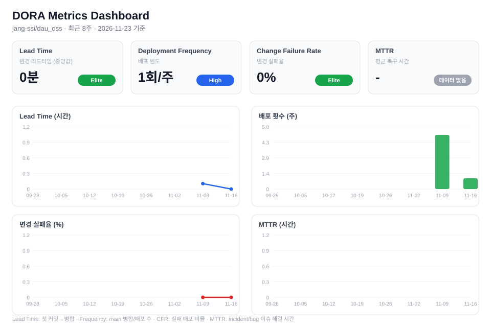
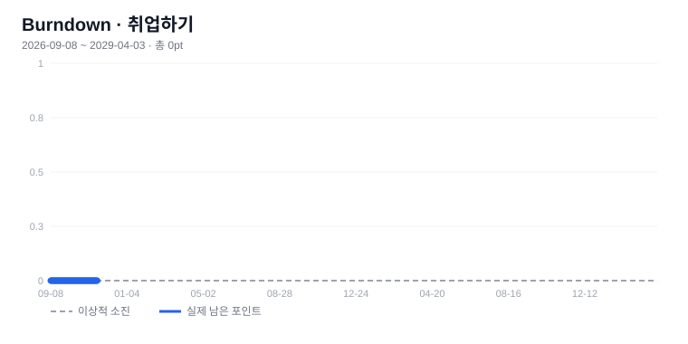

# dau_oss

[](LICENSE)
[](CONTRIBUTING.md)

동아대학교 2학년 2학기 오픈소스 소프트웨어 수업에서 GitHub 기반 협업과 자동화를 실습하는 저장소입니다.
React + TypeScript + Vite 웹 앱을 대상으로 브랜치 전략, 코드 리뷰, 문서화, CI/CD 파이프라인을 직접 구성합니다.

## 빠른 시작

```bash
git clone git@github.com:jang-ssi/dau_oss.git
cd dau_oss
npm ci
npm run dev
```

Node.js 20.19 이상이 필요합니다.

| 명령 | 설명 |
|------|------|
| `npm run dev` | 개발 서버 실행 |
| `npm run build` | 타입 검사 후 프로덕션 빌드 |
| `npm run lint` | oxlint 정적 분석 |
| `npm run preview` | 빌드 결과 미리보기 |

## 문서

| 문서 | 내용 |
|------|------|
| [CONTRIBUTING.md](CONTRIBUTING.md) | 브랜치 전략, 커밋 규칙, PR 절차 |
| [CODE_OF_CONDUCT.md](CODE_OF_CONDUCT.md) | 커뮤니티 행동 강령 |
| [라이선스 비교 분석](docs/oss/license-comparison.md) | 주요 OSS 라이선스 비교와 선택 기준 |
| [Inner Source 로드맵](docs/oss/inner-source-roadmap.md) | 조직 내부 적용을 위한 단계별 계획 |
| [Wiki](https://github.com/jang-ssi/dau_oss/wiki) | Getting Started, Development Guide, Troubleshooting |

## 기여하기

이슈와 PR을 환영합니다. 시작하기 전에 [기여 가이드](CONTRIBUTING.md)와 [행동 강령](CODE_OF_CONDUCT.md)을 읽어 주세요.

## 라이선스

[MIT License](LICENSE)로 배포합니다.

## DORA 지표

<!-- DORA:START -->
### 📊 DORA 주간 요약

- 저장소: jang-ssi/dau_oss
- 기간: 2026-11-02 ~ 2026-11-09
- 생성: 2026-11-09T05:07:54.298Z

| 지표 | 이번 주 | 지난주 | 등급 |
|------|---------|--------|------|
| Lead Time (중앙값) | - | - - | 데이터 없음 |
| Deployment Frequency | 0회/주 | 0회/주 = | Low |
| Change Failure Rate | - | - - | 데이터 없음 |
| MTTR (평균) | - | - - | 데이터 없음 |

표본: PR 0건 · 배포 0회 · 복구 이슈 0건



[전체 보고서](docs/dora/report.md) · 매주 월요일 GitHub Actions가 자동 갱신합니다.
<!-- DORA:END -->

## 스프린트 운영

- 설정 가이드: [docs/PROJECT_SETUP.md](docs/PROJECT_SETUP.md)
- 이슈 템플릿: Bug / Feature (`.github/ISSUE_TEMPLATE`)
- 분석 리포트: [docs/sprint/report.md](docs/sprint/report.md) (Cycle Time, Velocity, Burndown)


