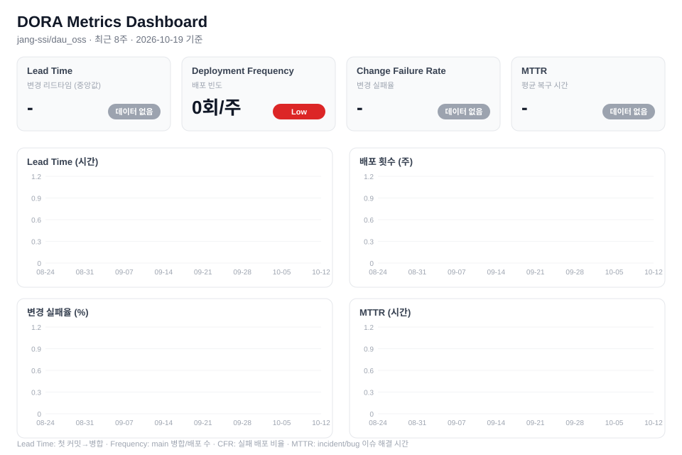

# dau_oss
26 DAU 2nd grade / 2nd semester

- Git/GitHub 개발 환경 구성 (계정, SSH 키, 테스트 저장소)
- 첫 커밋 및 푸시 테스트 완료

## DORA 지표

<!-- DORA:START -->
### 📊 DORA 주간 요약

- 저장소: jang-ssi/dau_oss
- 기간: 2026-10-19 ~ 2026-10-26
- 생성: 2026-10-26T03:44:08.373Z

| 지표 | 이번 주 | 지난주 | 등급 |
|------|---------|--------|------|
| Lead Time (중앙값) | - | - - | 데이터 없음 |
| Deployment Frequency | 0회/주 | 0회/주 = | Low |
| Change Failure Rate | - | - - | 데이터 없음 |
| MTTR (평균) | - | - - | 데이터 없음 |

표본: PR 0건 · 배포 0회 · 복구 이슈 0건

[전체 보고서](docs/dora/report.md) · 매주 월요일 GitHub Actions가 자동 갱신합니다.
<!-- DORA:END -->

## 스프린트 운영

- 설정 가이드: [docs/PROJECT_SETUP.md](docs/PROJECT_SETUP.md)
- 이슈 템플릿: Bug / Feature (`.github/ISSUE_TEMPLATE`)
- 분석 리포트: [docs/sprint/report.md](docs/sprint/report.md) (Cycle Time, Velocity, Burndown)

