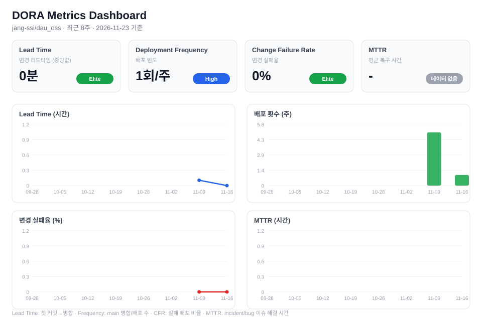

# DORA 주간 보고서

- 저장소: jang-ssi/dau_oss
- 기간: 2026-11-09 ~ 2026-11-16
- 생성: 2026-11-16T05:21:07.266Z

| 지표 | 이번 주 | 지난주 | 등급 |
|------|---------|--------|------|
| Lead Time (중앙값) | 6분 | - - | Elite |
| Deployment Frequency | 5회/주 | 0회/주 ▲ | High |
| Change Failure Rate | 0% | - - | Elite |
| MTTR (평균) | - | - - | 데이터 없음 |

표본: PR 5건 · 배포 5회 · 복구 이슈 0건

