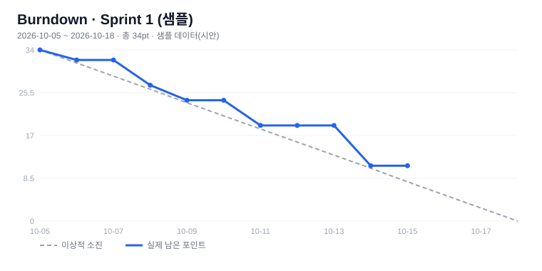
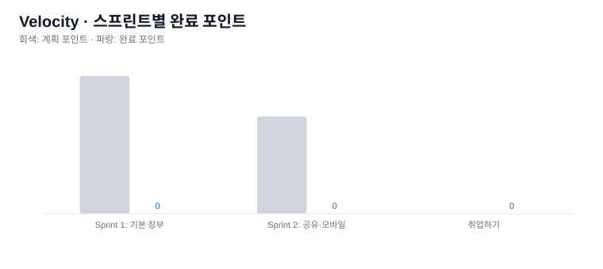

# 스프린트 분석 리포트

- 저장소: jang-ssi/dau_oss
- 생성: 2026-10-20T03:07:05.833Z

| 스프린트 | 기간 | 완료 이슈 | 완료/계획 포인트 | Velocity | Cycle Time(중앙값) |
|----------|------|-----------|------------------|----------|--------------------|
| Sprint 1: 기본 장부 | 2026-10-19 ~ 2026-11-01 | 0/8 | 0/34 | 0 | - |
| Sprint 2: 공유·모바일 | 2026-11-02 ~ 2026-11-15 | 0/5 | 0/24 | 0 | - |
| 취업하기 | 2026-09-08 ~ 2029-04-03 | 0/0 | 0/0 | 0 | - |

- 평균 Velocity: -pt/스프린트 (다음 스프린트 계획의 기준으로 사용)

## Burndown (Sprint 1: 기본 장부)

## Velocity

